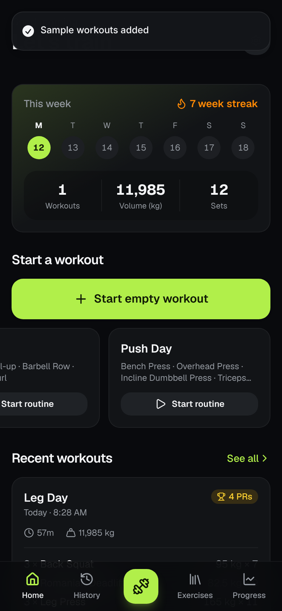
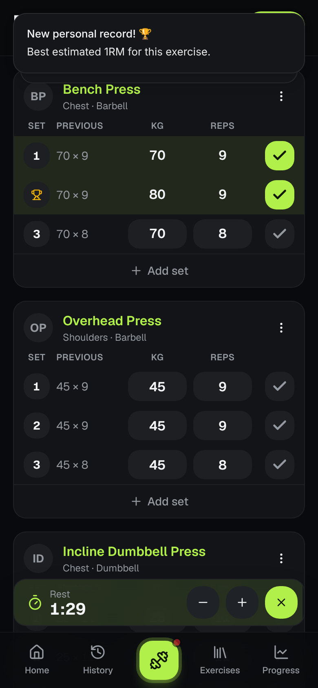
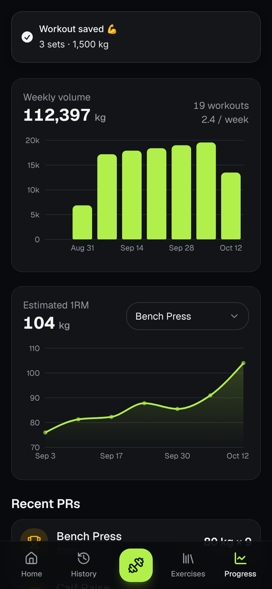
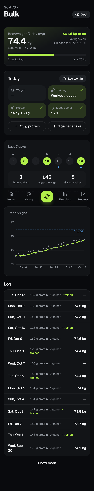

# Lift — Gym Tracker

A mobile-first workout logger built as an installable, offline-capable PWA.

**Stack:** Next.js 16 (App Router, TypeScript) · Tailwind CSS v4 · shadcn/ui-style components (Radix + Vaul) · Dexie (IndexedDB) · Recharts · Sonner

## Features

- **Log workouts**: exercises, sets, weight and reps. Each set shows what you did last time; empty fields fall back to it when you tick the set.
- **Routines**: save any workout as a routine and start it in one tap (sample Push / Pull / Legs included).
- **Rest timer**: starts automatically after each completed set (configurable), with ±15s and skip, plus a beep and vibration when it ends.
- **PR detection**: a set that beats your best estimated 1RM (Epley) is flagged with a trophy and a toast.
- **Exercise library**: 44 built-in exercises, filter by muscle group, add custom ones.
- **Progress**: weekly volume chart, estimated 1RM trend per exercise, recent PRs, per-exercise records and history.
- **Bulk log**: daily bodyweight, protein and mass gainer, with training days taken from logged workouts (or marked by hand). Shows the 7-day average weight against a goal weight you set yourself (on the Bulk screen or in Settings, or none), the weekly gain rate and a projected date.
- **History**: workouts grouped by month, with a detail sheet and delete.
- **Installable PWA**: manifest, icons and a service worker; the app loads and navigates with no connection.
- **Backup**: export / import all data as JSON, sample data loader, erase all.
- Dark theme by default, light and system themes available.

## Getting started

```bash
npm install
npm run dev        # http://localhost:3000
```

The service worker only registers in production, so to test install/offline:

```bash
npm run build && npm start
```

On a phone, open the deployed URL and use "Add to Home Screen" (iOS Safari) or "Install app" (Android Chrome). Any HTTPS host works (e.g. Vercel).

## Data: why local-first

All data lives in IndexedDB on the device (via Dexie). For a personal logger this means it works instantly and fully offline in the gym, needs no account or backend, and costs nothing to run.

The trade-off: data stays on one device/browser, and clearing site data deletes it. The app asks the browser for persistent storage and offers JSON export/import as a safety net.

**Adding cloud sync later** (e.g. Supabase) is the natural next step when you want multi-device or accounts. The storage engine is isolated so this stays contained:

- `src/lib/db/repo.ts`: all writes
- `src/lib/db/queries.ts`: all reads
- `src/hooks/use-data.ts`: live React hooks over the queries

The recommended approach is to keep IndexedDB as the local source of truth (so offline logging keeps working) and add a sync step in `repo.ts` that pushes changes to Supabase and pulls remote changes. Every record already uses a UUID primary key, so rows can be merged across devices without ID collisions.

## Project structure

```
src/
  app/                 routes: / , /workout, /history, /exercises, /exercises/detail, /progress, /settings
    manifest.ts        PWA manifest
  components/
    screens/           one client component per screen
    ui/                shadcn-style primitives (button, card, drawer, select, …)
    rest-timer.tsx     global rest timer (context + floating bar)
  hooks/               live data hooks, useNow
  lib/db/              Dexie schema, types, seed exercises, repo (writes), queries (reads)
public/
  sw.js                service worker (precaches app shell, offline navigation)
  icons/               app icons (regenerate with `npm run icons`)
```

## Notes

- `components.json` is set up so `npx shadcn add <component>` works when you add more shadcn components.
- Weight unit (kg/lb) is a display label; values are not converted.
- When you change `public/sw.js`, bump `VERSION` in it so installed clients refresh their cache.

## Screenshots

| Home                                  | Workout                                     | Progress                                      |
| ------------------------------------- | ------------------------------------------- | --------------------------------------------- |
|  |  |  |

| Bulk                                  |
| ------------------------------------- |
|  |
